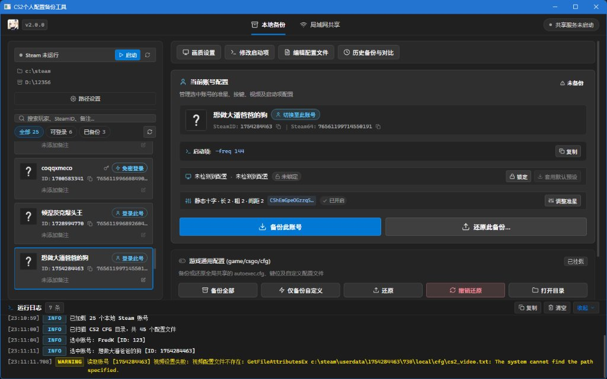
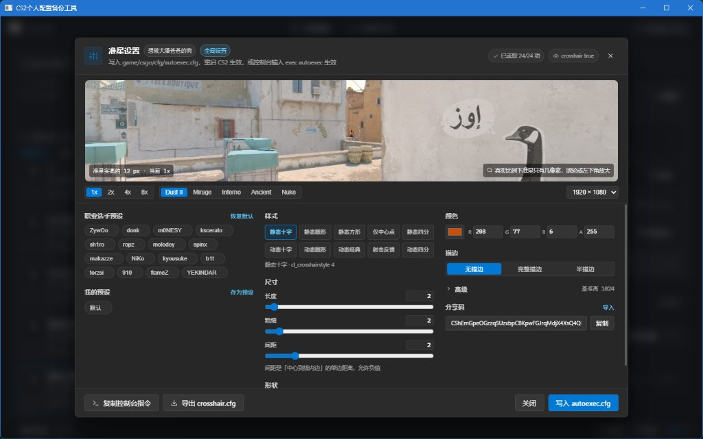
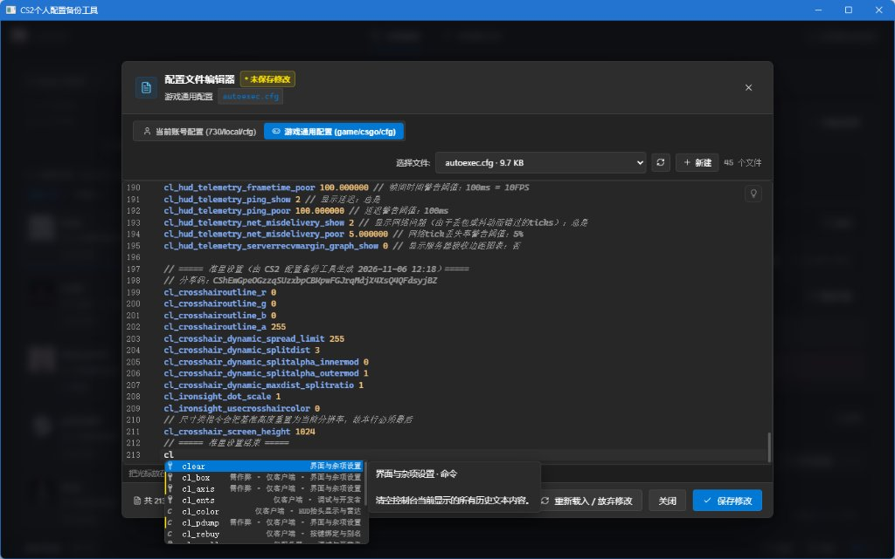
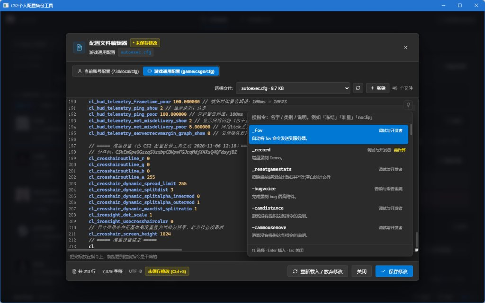
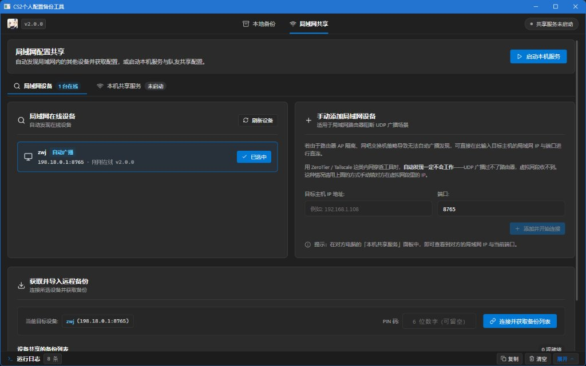

# CS2 个人配置备份工具 (CS2 Config Backup & Sync)

基于 Go (Wails v2) 与 Vue 3 开发的 CS2 个人配置备份与同步桌面应用。编译输出为独立的单文件绿色程序（`cs2backup.exe`），无需安装外部运行时，主要用于解决换机、网吧、重装系统等场景下准星、按键、视频设置及 autoexec 脚本的丢失与迁移问题。

---

## 功能概览

- **多账号管理与原生免密切号**：解析本地 Steam `loginusers.vdf`，识别记住密码的账号。切号直接通过 Steam 官方命令行机制配合注册表联动启动，不存取任何明文密码与凭据。
- **双轨配置备份与还原**：
  - **用户私有配置**（`userdata/<account_id>/730`）：包含按键绑定（`cs2_user_keys.vcfg`）、视频画质（`cs2_video.txt`）、音频与核心控制台变量（`cs2_machine_convars.vcfg`）。
  - **游戏通用脚本**（`game/csgo/cfg`）：包含 `autoexec.cfg`、跑图及训练脚本。自动甄别 Valve 官方文件与第三方平台文件，支持仅备份自定义脚本。
- **快照与回退机制**：备份数据按文件内容哈希去重；每次执行还原前自动归档现场文件至 `restore_originals/`，支持还原误操作后一键回退。
- **2026 像素制准星工坊**：适配 Valve 新版准星像素规范与 32 字节分享码格式，内置多张竞技地图实景对焦与选手预设，支持一键将准星写入 `autoexec.cfg`。
- **内置 CFG 编辑器**：基于 CodeMirror 6，内置 5800+ 条 CS2 引擎指令词典，提供模糊补全、官方参数说明文档及作弊指令警示。
- **局域网免 U 盘共享**：内置基于 HTTP/WebSocket 的局域网同步服务与 UDP 设备广播发现，支持在多台设备间快速推送与拉取配置包。

---

## 界面与使用说明

### 1. 主控制台与账号配置

启动工具后会自动检测本地 Steam 安装路径与全部历史登录账号。选中账号即可查看其启动项、视频分辨率及准星概要。



- **备份**：点击「备份此账号」可将当前账号的 730 配置生成快照；点击「备份全部」或「仅备份自定义」可备份游戏根目录下的通用 cfg。
- **还原与回退**：点击「还原此备份」可选择从历史版本或其他账号克隆配置；若还原后需要恢复，可点击「撤销还原」恢复至操作前状态。
- **切号**：对于本地记住密码的账号，可直接点击「免密登录」或「切换至此号」，工具会调起 Steam 并以该账号登录。

### 2. 准星工坊

点击主界面的准星卡片即可呼出准星设置抽屉。



- **场景预览**：提供 Dust II、Mirage、Inferno、Ancient、Nuke 游戏实景，支持 1x / 2x / 4x / 8x 放大查看。
- **预设与分享**：内置现役选手预设，支持导入/导出官方分享码。
- **写入配置**：调整完成后点击「写入 autoexec.cfg」，工具会在 `autoexec.cfg` 中以自包含区块形式写入准星指令，并自动处理旧版本废弃参数与基准高度。

### 3. 配置文件编辑器

在顶栏点击「编辑配置文件」可直接编辑目标账号配置或通用 cfg。





- 支持在「当前账号配置」与「游戏通用配置」之间切换。
- 键入指令时提供模糊补全提示，右侧展示参数官方说明。
- 依赖 `sv_cheats 1` 的作弊指令会以高亮徽标提示，避免实战 autoexec 写入无效指令。

### 4. 局域网同步

切换至顶部的「局域网共享」标签页，可进行设备间配置互传。



- **共享端**：点击「启动本机服务」即可开启共享，可设置 6 位安全 PIN 码与传输限速。
- **接收端**：工具通过 UDP 广播自动扫描局域网内的在线设备，也可通过目标 IP 与端口手动直连，直接拉取并导入远程备份包。

---

## 开发与构建

### 环境要求

- **操作系统**：Windows 10 / 11 64-bit
- **Go**：1.22 及以上
- **Node.js**：18 及以上（建议使用 `pnpm`）
- **Wails CLI**（仅源码开发调试需要）：
  ```bash
  go install github.com/wailsapp/wails/v2/cmd/wails@v2.17.1
  ```

### 本地开发

克隆代码并安装前端依赖：

```bash
git clone https://github.com/mu1T/cs2backup111123.git
cd cs2backup111123

# 安装前端依赖
cd frontend
pnpm install
cd ..

# 启动 Wails 调试服务（支持前后端热重载）
wails dev
```

### 生产打包

项目根目录提供了完整的一键编译脚本 `build.bat`。该脚本会自动构建前端产物、通过 `go-winres` 注入应用图标与清单，并编译生成最终的单文件可执行程序：

```cmd
.\build.bat
```

构建成功后将在根目录生成 `cs2backup.exe`（体积约为 13 MB）。

### 测试运行

```bash
# 运行前端单元测试
cd frontend
npx vitest run

# 前端类型检查
npx vue-tsc --noEmit

# 运行 Go 后端单元测试
cd ..
go test ./internal/... -count=1
```

---

## 目录结构

```text
cs2backup111123/
├── app.go                      # Wails 暴露给前端的绑定接口定义
├── main.go                     # 应用入口与窗口初始化配置
├── build.bat                   # 生产环境一键构建脚本
├── internal/
│   ├── app/                    # 业务协调服务层
│   ├── backup/                 # Userdata 与通用 CFG 备份/快照/差异对比
│   ├── crosshair/              # 2026 准星模型、分享码编解码与预设
│   ├── lan/                    # 局域网 HTTP/WebSocket 传输与 UDP 广播
│   ├── steam/                  # Steam 路径自检测、账号解析与切号控制
│   └── video/                  # 视频画质参数读取与预设管理
├── frontend/
│   ├── src/
│   │   ├── components/         # 视图组件（准星、编辑器、卡片等）
│   │   ├── composables/        # 业务逻辑组合式函数
│   │   ├── utils/              # 纯函数工具类（CFG解析、几何计算等）
│   │   └── views/              # 本地备份与局域网主视图
│   └── wailsjs/                # Wails 生成的前后端契约绑定层
└── img/
    ├── app_icon.ico            # 应用图标
    └── screenshots/            # 功能界面截图
```

---

## 开源协议

本项目基于 [MIT](LICENSE) 许可证开源。
